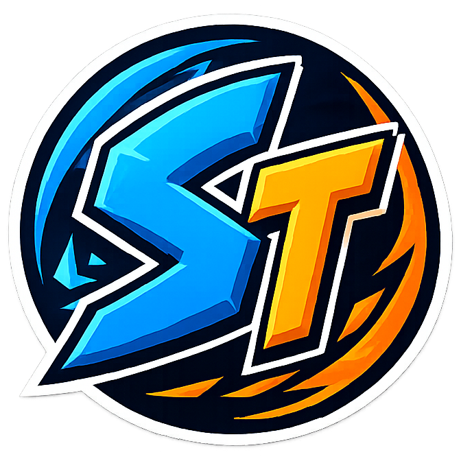

##  StreamTweak

   [](https://claude.ai/code) [](https://ko-fi.com/foggybytes)

<div align="center">
  
</div>

**StreamTweak** is the host half of the FoggyBytes streaming duo. It takes care of the setup that makes game streaming reliable — the network link, spatial audio, the game library, the NVIDIA driver profile — and keeps a record of how every session actually went.

Paired with its companion client [**StreamLight**](https://github.com/FoggyBytes/StreamLight) the two work as one: the client asks for the link speed it needs, the host reports what is happening to a launch, and telemetry, store metadata, Tailscale presence and remote power and update controls travel between them over a local TCP bridge.

<div align="center">
  
</div>

## ✅ Compatibility

Windows 10 21H2 and later, alongside [Sunshine](https://github.com/LizardByte/Sunshine), [Apollo](https://github.com/ClassicOldSong/Apollo), [Vibeshine](https://github.com/Nonary/vibeshine) or [Vibepollo](https://github.com/Nonary/Vibepollo).

Everything host-side works on its own. The paired features need [**StreamLight**](https://github.com/FoggyBytes/StreamLight) on the client, and the newest of them — client-driven link speed, the launch report, the shared session card and the PIN pad — need **StreamLight 5.0.0 or later**; the host section, where a client manages this host from the sofa, needs **StreamLight 8.0.0**. Older clients keep the rest of the integration and simply never ask for what they don't know about.

> 🔐 **The bridge is authenticated.** It accepts commands only from StreamLight devices you have approved: a one-time prompt shows a 4-digit PIN to confirm against the one on the device, and every command afterwards is signed with that client's Moonlight certificate. **Streaming is never gated by it** — approval only unlocks the paired features. A device asking for access shows up at the top of **Status**, and under **Setup › Clients**.

> ⚠️ **Windows SmartScreen and Smart App Control.** StreamTweak is not code-signed yet.
> - **SmartScreen** may warn you when you run the installer: choose *More info → Run anyway*.
> - **Smart App Control**, on the Windows 11 PCs where it is turned on, may block StreamTweak outright, and it offers no per-app exception. The only way to run it there is to turn Smart App Control off (*Windows Security → App & browser control → Smart App Control settings*).
>
> Keeping Smart App Control on is a perfectly reasonable choice. Code signing is being looked into, and this note will be updated if that changes. The full source is in this repository.

> 🛡️ **Security and privacy.** No analytics, no telemetry, nothing sent to FoggyBytes. How StreamTweak is protected and how to report a vulnerability is in [SECURITY.md](SECURITY.md); every connection it makes is listed in [PRIVACY.md](PRIVACY.md).

## 🔥 Features

Everything below is in the current release, whichever version first introduced it.

**🧭 Status and Setup** *(10.0.0)*
- **Status** — the page StreamTweak opens on: a header drawn from the covers of the games on this PC, saying whether the host is ready to stream, with its link speed, the games listed and the last session's grade; a device asking for access, with its PIN and *Approve*, *Approve with host management* or *Deny*; the stream running now, with *Return to client*; then eight tiles, one per component — service, bridge port, streaming server, library, managed apps, spatial audio, network, NVIDIA Sentinel — green, amber or red, each opening the page that sets it. On a first run the same page walks through the four steps that matter
- **Setup** — what you set once on this host, in its own block of the sidebar: Clients, Network, Apps, Spatial audio and NVIDIA Sentinel — the same names StreamLight 8.0 uses. Apps, spatial audio and Sentinel can also be switched from StreamLight 8.0's StreamTweak section, by a device with Host management. The everyday switches and the live figures are on the client

**🌐 Network**
- **Link-speed switch** — the client reads its own wired link and asks the host to match it **before** connecting; the stream starts once the change is confirmed. This is what fixes the packet loss and latency spikes caused by host and client NICs negotiating at different speeds — a 2.5 Gbps host feeding a 1 Gbps handheld sends each frame as a burst the slower link cannot drain, and the few packets carrying audio die first
- **You stay in control of your hardware** — one permission switch decides whether clients may touch the adapter at all, the link is never changed while a session is running, and a manual restore is one click away. The host holds the speed until it is asked to put it back, so the gap between two games costs nothing
- **Wired only** — Ethernet adapters that expose a speed setting, nothing else. Wi-Fi has no fixed link speed to match, and a request arriving over Wi-Fi or Tailscale is refused
- **No UAC, ever** — a LocalSystem service performs the adapter changes over a named pipe
- **[Tailscale](https://tailscale.com) detection** — the host's Tailscale IP is shown in the title bar, beside this PC's LAN address, one click to copy, and the client tracks it on the host's tile for streaming from outside the LAN with no port forwarding

**🎬 Launch and lock state**
- **The host reports the launch** — StreamTweak follows the game the streaming server was asked to open and reports whether it is still starting, has a window, is on screen, or is waiting for a click, so the client can cover the wait with its own screen instead of showing a desktop mid-reconfiguration
- **Launcher-aware** — a store client asking for a login is reported as needing attention, while a launcher that simply starts the game and steps aside is not: the check is whether the game's own process has appeared, because watching windows alone cannot tell the two apart. A window already open when the launch began is never mistaken for a prompt
- **The host says whether it is locked** — so a client that has just woken it can offer a PIN pad instead of leaving you with a host that answers pings and does nothing else. StreamTweak types nothing and unlocks nothing itself: the PIN travels on the streaming connection, the same path as any other keystroke
- **The unlock is kept out of your history** — the brief session that carries the PIN is not recorded, switches on no spatial audio, closes no managed apps and credits no game

**🎧 Spatial audio**
- **Auto spatial audio** — Dolby Atmos for Headphones or Windows Sonic activated shortly after a session starts, on the output device of your choice, with live per-device availability shown before you commit

**🛡️ NVIDIA Sentinel** *(NVIDIA GPUs only)*
- **Profile snapshot** — capture the NVIDIA global driver profile to a `.nip` file, restore it, or clear it. The header shows the driver package, version and release date
- **Auto-restore** — armed, StreamTweak watches the driver settings database and silently re-applies your saved profile within seconds whenever NVIDIA App resets it, logging every restore
- **Readable settings panel** — each customised setting with its NVIDIA label, and the real installed DLSS SR / RR / FG versions
- **No external dependency** — a native port of NVIDIA Profile Inspector's DRS layer (MIT, © Orbmu2k), decrypter included, so encrypted "internal" settings are captured and restored correctly

**🎮 Game library sync**
- **Multi-store discovery** — Steam, Epic Games, GOG, Ubisoft Connect, Xbox / Game Pass, EA App and Battle.net, synced into the streaming server's app list without touching entries you created by hand
- **Native cover art** — fetched from each store and cached as PNG. A cover has to be full size to be accepted, so the search carries on past the small thumbnail a launcher keeps for its own grid, and a cover already downloaded is never replaced by a smaller one
- **Each store launched the way it expects** — Steam and Epic through their launcher's own protocol, Xbox through the UWP shell, Battle.net through its client. Most Epic games cannot be started from their executable at all: the entitlement tokens arrive on the command line from the launcher
- **One row per game, with the exact command** — what StreamTweak wrote in the streaming server, so what you read is what the server runs. **Play** runs that same command on this PC, to test it
- **Exclude** — a game stays in the list and out of the streaming server at every sync, whoever starts it; **Include again** brings it back
- **Sync and restart** — the servers read their app list only when they start, so the sync restarts the streaming server's own service, through the LocalSystem service and Windows' service manager, and waits until it answers again. Refused while a device is streaming or a game it launched is still open
- **Manual entries** — add any executable that was not detected, and keep it across re-syncs
- **Host tile replacement** — swap the streaming server's Desktop and Steam tiles for bundled artwork, reversibly and with no UAC. They stay replaced: a server update reinstalls its own, and StreamTweak puts yours back

**🗂️ Streaming app manager**
- Apps to close when a session starts and reopen when it ends — Hue Sync, RGB suites, anything that fights with the client — with a per-app switch to exclude one without removing it. **Add app** offers the programs running now first, then any program on disk

**📋 Sessions and telemetry**
- **Full session log** — every session with duration, RTT, drop rate, and the games it played with their covers, and the codec of each stream. Optionally, sessions that never launched a game are discarded rather than recorded
- **Quality report** — open any session for its client and host stats, a grade of Excellent / Good / Poor with the four checks behind it, and one timeline of RTT, host frame latency, drops, bitrate, decode latency, host compute and host power (board power against the power limit in force, and GPU temperature, on NVIDIA), with zoom, a Focus view and full screen
- **Compare two sessions** side by side, with per-metric deltas

## 🔗 Paired Features (with StreamLight)

These cross the bridge and need both apps. The version shown is the **minimum StreamLight** on the client.

- **Host section** *(8.0.0+)* — StreamLight's StreamTweak section reads this host's dashboard, managed apps and NVIDIA Sentinel over `DASHBOARD`, `APPS` and `NVIDIA` (plus RAM in `STATS`) its session history over `SESSIONS`, `SESSION`, `SERIES` and `COVER` (every series of Host compute and Host power from 10.0.4, for StreamLight 8.0.1) and its game library over `LIBRARY`, read-only, and turns apps, spatial audio and Sentinel's auto-restore on or off with `SETAPP`, `SETAUDIO` and `SETSENTINEL` — switches only, never a path or a command — plus one action, `LIBSYNC`: sync the library and restart the streaming server through Windows' service manager, after the checks in SECURITY.md. Writing needs the device's **Host management** permission, granted under Setup › Clients; devices approved before 10.0.0 have it on. Each session also records which device it was streamed to

- **Client-driven link speed** *(5.0.0+)* — the client reads the adapter over `NETINFO`, asks for a matching speed with `SETSPEED`, and waits for the host to confirm before launching. The host keeps the permission, the safety guards and the restore
- **Launch state** *(5.0.0+)* — `GAMESTATE` reports what is happening to the game the server was asked to open, so the client can hold its own launch screen up until the game is really there
- **Game still running after Quit** *(7.0.2+)* — `GAMEALIVE` tells the client whether the last game launched still has a process here, so a Quit the streaming server could not carry out (an Xbox app game) is reported on the client
- **Remote PIN unlock** *(5.0.0+)* — `LOCKSTATE` tells a client that has just woken the host whether it came up at the lock screen, and the client offers a PIN pad. The session carrying the PIN is declared as such and kept out of the history
- **Last session on the client's home screen** *(5.0.0 – 5.6.1)* — `LASTSESSION` serves the host's most recent finished session with thumbnail cover art. ⚠️ **StreamLight stopped asking for it in 5.7.0**, where that card became the game *you* last played, kept by the client itself and working against a plain Sunshine host. Nothing was removed from the bridge — the verb is still served, and an older client still gets its answer. The reason it was replaced is the sentence that always followed it here: it is the *host's* last session, and StreamTweak keeps no record of which client a session belonged to
- **Host metrics in the overlay** *(1.2.0+)* — GPU %, encoder %, GPU temperature, VRAM, CPU and network TX, over `STATS`
- **Store badges on covers** *(2.0.0+)* — the per-game store map, over `APPSTORES`
- **Session quality reports** *(2.1.0+)* — client telemetry every second; StreamTweak computes the grade and draws the session's timeline
- **Delivered vs target bitrate** *(4.5.0+)* — the client reports the rate it was told to aim for, so a session's report can show what was actually delivered against it
- **Remote session pause** *(2.3.0+)* — "Return to client" on Status ends the stream client-side
- **Remote host power-off** *(3.2.0+)* — an approved client can shut down the host, itself, or both. Destructive, so it only ever fires on a verified signature
- **Remote sleep and restart** *(6.2.0+)* — the host reports the power options it really has, and the client offers only those
- **Remote Windows Update** *(3.3.0+)* — scan, classify and install updates on the host and reboot it, or install them as part of a shutdown, all from the client with no keyboard on the host. The privileged work runs in the LocalSystem service
- **Tailscale presence** *(3.0.0+)* — the host's `100.x.y.z` address is offered over `TAILSCALE`, and the client tracks it on the host's single tile alongside the LAN address
- **Shared clipboard** *(6.3.0+)* — text copied on either side pastes on the other while a stream runs, up to 32 KB, sealed with a per-stream AES key that only the device's certificate can open. Passwords are cleared on the receiving side within 60 seconds. Switched in Settings here, and on the device too

## ✨ What's New in 10.0.5 — "The Right Game Update"

- **Steam software stays out of the library** — Wallpaper Engine, Lossless Scaling, OBS Studio and the like are no longer synced as games, so they stop showing up as the game you played

## ✨ What's New in 10.0.4 — "The Full Picture Update"

Pairs with StreamLight 8.0.1.

- **The whole timeline on the client** — StreamLight's Sessions tab now gets every series of Host compute and Host power: encoder, CPU, power limit, GPU temperature and the moments at the limit
- **Covers come back** — a past session's game that lost its cover and is no longer installed gets it again from Steam

## ✨ What's New in 10.0.3 — "The Steady Reading Update"

- **Net TX stays put** — the host's outbound traffic in StreamLight's overlay no longer drops to N/A for a second every 30 seconds

## ✨ What's New in 10.0.2 — "The Quiet Hours Update"

- **Sentinel waits for the stream to end** — what the streaming server changes in the driver profile for a stream, like the frame limiter's V-Sync, stays as it is until the stream is over; your profile is checked once right after

## ✨ What's New in 10.0.1 — "The Good Neighbor Update"

- **Sentinel lets the streaming server be** — the Vulkan/OpenGL present method that Sunshine and its forks set when they start is no longer taken out by auto-restore

## ✨ What's New in 10.0.0 — "The Hand Off Update"

Pairs with StreamLight 8.0.0.

- **Managed from the sofa** — StreamLight 8.0's new StreamTweak section reads this host's dashboard, session history, game library, apps and NVIDIA Sentinel, can sync the library and restart the streaming server, and switches managed apps, spatial audio and Sentinel's auto-restore; the change shows up here at once
- **Host management** — a permission per device under Setup › Clients decides who may change anything; approval offers *Approve with host management*, *Approve* or *Deny*, and devices approved earlier keep it on, named once in a notice
- **Who streamed** — each session now records the StreamLight device it was streamed to
- **Every game followed** — a game the server launched is tracked for as long as it runs, even outside the Game Library, so an Xbox app game no longer drops off the timeline after a minute
- **A lighter StreamTweak** — it opens on **Status**, what a stream will find and what needs you; the one-time settings sit in **Setup**; the **Library** lists each game with the command the server runs, **Exclude**, **Sync and restart** and **Clear library**. The Dashboard and the Display page are gone: the live figures and the everyday switches are in StreamLight, and HDR is the streaming server's job

*Older releases are in [changelog.txt](changelog.txt).*

## 🏗️ Architecture

Three components:

- **`StreamTweakUI.exe`** — the WinUI 3 tray app, unprivileged, on Windows App SDK 2.4
- **`StreamTweak.Core`** — shared logic: NIC control, audio, game library, telemetry, NVIDIA Sentinel, Tailscale detection, the TCP bridge
- **`StreamTweakService.exe`** — a LocalSystem Windows Service reached over a named pipe, which performs the NIC changes, host-asset writes and Windows Update work, so no UAC prompt ever appears

The bridge is a TCP listener on **port 47998** (LAN, line-delimited ASCII). Commands accepted from StreamLight: `NETINFO`, `SETSPEED`, `RESTORE`, `STATUS`, `STATS`, `APPSTORES`, `TAILSCALE`, `SESSIONDATA`, `GAMESTATE`, `LASTSESSION`, `LOCKSTATE`, `UNLOCKBEGIN` / `UNLOCKEND`, and the power and update set `POWERCAPS`, `POWER`, `SHUTDOWN`, `SHUTDOWN_UPDATE`, `UPDATESTATE`, `UPDATECHECK`, `UPDATE_NOW`, `UPDATEPROGRESS`. A client negotiates with `CAPS`, enrolls its Moonlight certificate once with `ENROLL`, and signs every command afterwards with `AUTH1` (RSA-SHA256). Destructive commands additionally require a verified signature.

```
StreamLight (Qt, client PC)
    │  TCP port 47998
    ▼
StreamTweak (WinUI 3, host PC)  →  Named Pipe  →  StreamTweakService (LocalSystem)
                                                           │
                                                           ▼
                                                NIC speed via CIM/WMI
                                                Host assets via filesystem
                                                Windows Update via WUA
```

## 📝 Installation

Download the latest installer from the [Releases](https://github.com/FoggyBytes/StreamTweak/releases) page and run it.

It registers `StreamTweakService` as a LocalSystem Windows Service, which is what keeps NIC and host-asset operations free of UAC prompts. The Windows App SDK 2.4 runtime is fetched only if missing, and installs alongside any older 1.x runtime, so upgrading from 7.x needs no uninstall.

## 🙏 Support the Project

StreamTweak is free, with no ads and no telemetry. If it made your streaming better, you can support its development on Ko-fi.

[](https://ko-fi.com/foggybytes)

## 🤝 Acknowledgements
- [**StreamLight**](https://github.com/FoggyBytes/StreamLight) — the companion client, designed in lockstep with StreamTweak
- [**Moonlight**](https://github.com/moonlight-stream/moonlight-qt) — the open-source streaming client that inspired this project
- [**Sunshine**](https://github.com/LizardByte/Sunshine) — the streaming host that started it all
- [**Apollo**](https://github.com/ClassicOldSong/Apollo) — community-driven Sunshine fork
- [**Vibeshine**](https://github.com/Nonary/vibeshine) and [**Vibepollo**](https://github.com/Nonary/Vibepollo) — fully supported
- [**NVIDIA Profile Inspector**](https://github.com/Orbmu2k/nvidiaProfileInspector) by Orbmu2k (MIT) — its DRS layer and setting catalog were ported natively to power NVIDIA Sentinel

## License
[](https://www.gnu.org/licenses/gpl-3.0)
